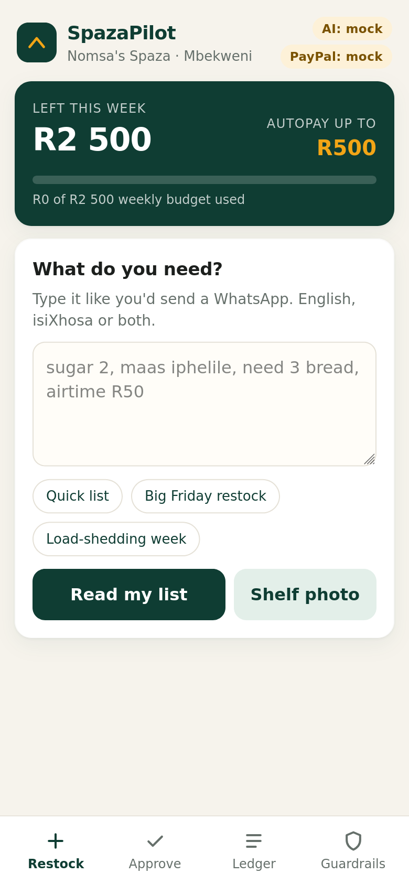
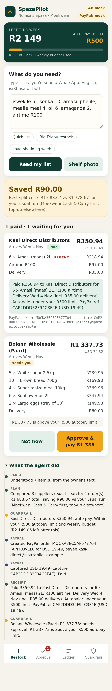
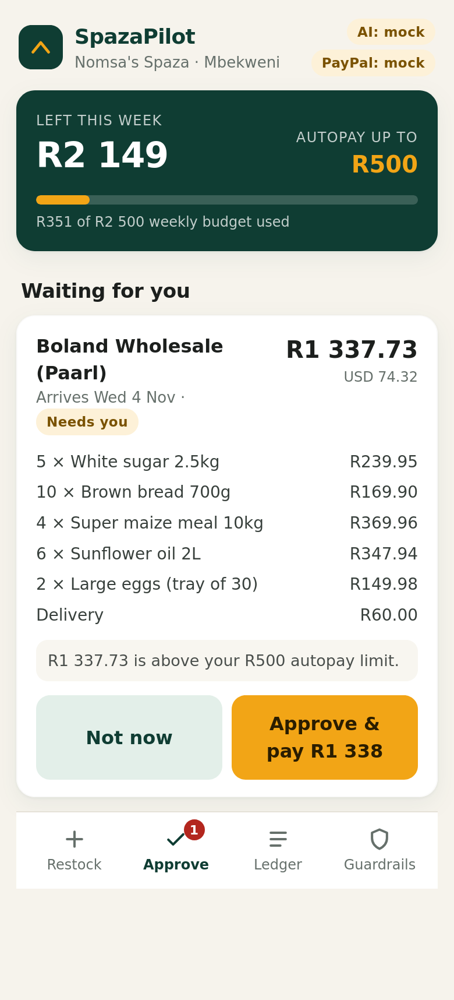
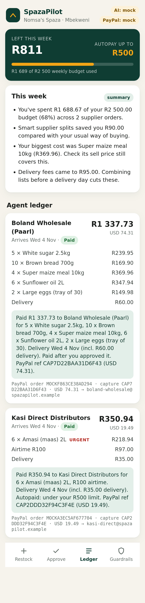

# SpazaPilot

**An AI restocking and payment agent for South African township spaza shops.**
The owner sends a messy note ("sugar 2, maas iphelile, need 3 bread, airtime R50") or a shelf photo.
SpazaPilot works out what's needed, finds the cheapest valid split across wholesalers, and **pays the
suppliers through PayPal on its own**, but only inside spending guardrails the owner sets. Anything
bigger waits for a one-tap approval. Every step lands in a plain-language ledger.

Built for the PayPal AI Hackathon (agentic commerce track).

| Restock | Agent result | Approval | Ledger + insight |
|---|---|---|---|
|  |  |  |  |

---

## How it works

```
 owner note / shelf photo
          │
   1. PARSE ── AI (OpenAI-compatible or Gemini) → validated against catalogue
          │      (offline isiXhosa/English lexicon parser in mock mode or as fallback)
   2. PLAN  ── basket optimiser: cheapest total incl. delivery fees, every supplier
          │      minimum met, out-of-stock items only from suppliers delivering next day
   3. GUARD ── code-enforced policy per supplier order:
          │      AUTO_PAY  │ NEEDS_APPROVAL │ BLOCKED
   4. PAY   ── PayPal Orders v2: create order (supplier = payee) → capture
          │      idempotent PayPal-Request-Id on every call
   5. EXPLAIN ─ AI writes the receipt + weekly spend insight (numbers come from the ledger)
          │
   6. LEDGER ── every order, PayPal order/capture id, status and the agent's trace
```

**The model never decides whether money moves.** It reads notes and photos and writes explanations.
Budgets, limits, supplier allowlists and duplicate checks are plain Python in `app/guardrails.py`,
evaluated before any PayPal call.

### Guardrails

| Rule | Effect |
|---|---|
| Weekly budget (default R2 500, Mon–Sun SAST), counting paid + in-flight orders | **Blocked** |
| Supplier not verified / not on allowlist | **Blocked** |
| Order below the supplier's minimum | **Blocked** (with shortfall) |
| Order above the autopay limit (default R500) | **Needs owner** |
| Unusual quantity (>60 units/line, airtime > R500) | **Needs owner** |
| Same basket to same supplier paid in the last 24h | **Needs owner** |
| Autopay switched off | **Needs owner** |
| Owner approves later | Hard limits are **re-checked** at approval time |

### PayPal APIs used

| Call | Why |
|---|---|
| `POST /v1/oauth2/token` | client-credentials token (cached) |
| `POST /v2/checkout/orders` | one order per supplier, `intent: CAPTURE`, `purchase_units[].payee.email_address` = the supplier's sandbox business account, itemised `items` + `breakdown` (item_total + shipping), `invoice_id`/`custom_id` for reconciliation |
| `POST /v2/checkout/orders/{id}/capture` | capture once approved |
| `GET /v2/checkout/orders/{id}` | reconcile |
| `POST /v3/vault/setup-tokens` + `POST /v3/vault/payment-tokens` | optional one-time "Link PayPal wallet": the owner approves once, then the agent pays with `payment_source.paypal.vault_id` and no redirect |

Two payment paths in real (sandbox) mode:

1. **Wallet linked (vault_id)**: orders inside the guardrails are created and completed by the agent with no redirect. This is the full agentic path.
2. **No wallet linked**: the agent creates the order and the owner taps **Confirm in PayPal** (sandbox approval page); PayPal redirects to `/api/paypal/return`, which captures.

PayPal doesn't settle in ZAR, so orders are charged in **USD** at `ZAR_PER_USD` (default 18.00). The UI shows both.

---

## Quick start (mock mode, no keys)

Requires Python 3.10+.

```bash
cd spazapilot
python -m venv .venv && source .venv/bin/activate
pip install -r requirements.txt
uvicorn app.main:app --reload
# open http://localhost:8000
```

With no keys set, the app runs end-to-end in **mock mode**: a deterministic English/isiXhosa parser
and a simulated PayPal that returns real-shaped Orders v2 responses (`APPROVED` → capture
`COMPLETED`). The header shows `AI: mock` / `PayPal: mock`.

Try it:
1. Tap **Big Friday restock** → **Read my list** → **Let SpazaPilot restock**.
2. The Kasi Direct order (under R500) autopays; the Boland order waits for you.
3. Open **Approve**, tap **Approve & pay**, then check the **Ledger** for receipts and the weekly insight.
4. Under **Guardrails**, drop the weekly budget to R500 and run another list to watch it get blocked.

## Tests

```bash
pip install -r requirements-dev.txt
python -m pytest -q
```

49 tests cover: parsing (English, isiXhosa, number words, pack sizes vs quantities, AI-output
validation and fallback), basket optimisation (fees, minimums, urgent delivery, infeasible baskets,
savings), guardrails (every rule above), the PayPal client against a mocked HTTP transport (auth +
token caching, idempotency headers, payload maths, redirect and vault flows, error surfacing), the AI
client request shapes (OpenAI-compatible + Gemini), the full HTTP agent loop in mock mode, and the
real-mode loop wired to the real PayPal client against mocked sandbox HTTP (redirect approval, linked
wallet, payee error, wallet linking).

Screenshots: `pip install playwright && python -m playwright install firefox && python scripts/screenshots.py`
(starts its own mock server on port 8765 with a throwaway DB and writes `docs/screenshots/`).

## Real mode (PayPal sandbox + AI)

1. **PayPal developer account** at <https://developer.paypal.com> → *Apps & Credentials* (Sandbox) →
   *Create App* (Merchant). Copy the **Client ID** and **Secret**.
2. **Sandbox accounts** (*Testing Tools → Sandbox Accounts*): use the default **personal** account as
   the shop owner (payer). Create one to three extra **business** accounts as suppliers (payees).
3. **AI key**: an OpenAI-compatible key (`AI_PROVIDER=openai`, optionally `AI_BASE_URL`) or a Google
   AI Studio key (`AI_PROVIDER=gemini`).
4. `cp .env.example .env` and fill in `PAYPAL_CLIENT_ID`, `PAYPAL_CLIENT_SECRET`,
   `PAYPAL_DEFAULT_PAYEE_EMAIL` (or `SUPPLIER_PAYEE_EMAILS`), `AI_PROVIDER`, `AI_API_KEY`.
5. `uvicorn app.main:app` → the header switches to `PayPal: sandbox` and `AI: <provider>:<model>`.
6. Optional: for hands-free autopay, enable **Vault** in the sandbox app (*App feature options →
   Accept payments → Advanced options → Vault*) and tap **Guardrails → Link PayPal wallet** once. If
   vaulting isn't available for your account, everything still works through the Confirm in PayPal path.

`PUBLIC_BASE_URL` must match the URL you open the app on, because PayPal redirects back to it.

## Project layout

```
app/
  main.py           FastAPI routes + static UI
  agent.py          the agent loop: plan → guard → pay → receipt → ledger
  parser.py         AI + offline parsing (text and photo)
  optimizer.py      supplier basket optimiser
  guardrails.py     spending policy (pure functions)
  paypal_client.py  Orders v2 / Vault v3 client + mock
  ai.py             OpenAI-compatible + Gemini JSON client
  narrate.py        receipts and weekly insights
  catalogue.py      seeded products and 3 fictional wholesalers
  db.py             SQLite: settings, runs, orders (ledger), events (audit trail)
static/             index.html, app.js, styles.css (no build step)
tests/              pytest suite
scripts/            screenshots.py
```

## Notes and limits

- Suppliers, prices and payee emails are **fictional seed data** for the demo.
- Mock vision returns a fixed sample detection; real photo parsing needs an AI key with vision.
- PayPal tooling: [`paypal/AI-Toolkit`](https://github.com/paypal/AI-Toolkit) is a plugin for coding
  agents (Claude Code, Codex, Cursor): best-practice skills plus the sandbox MCP server. It helps
  during development but doesn't run inside the app. The runtime
  [`paypal/agent-toolkit`](https://github.com/paypal/agent-toolkit) wasn't used. SpazaPilot calls the
  REST APIs directly so the guardrail check sits in the same code path as every payment, and its
  steps map onto the toolkit's order tools (create, capture, get) if you'd rather swap them in.
- `/api/demo/reset` only works in mock mode or with `SPAZAPILOT_ALLOW_RESET=1`.

## License

MIT. See [LICENSE](LICENSE).
